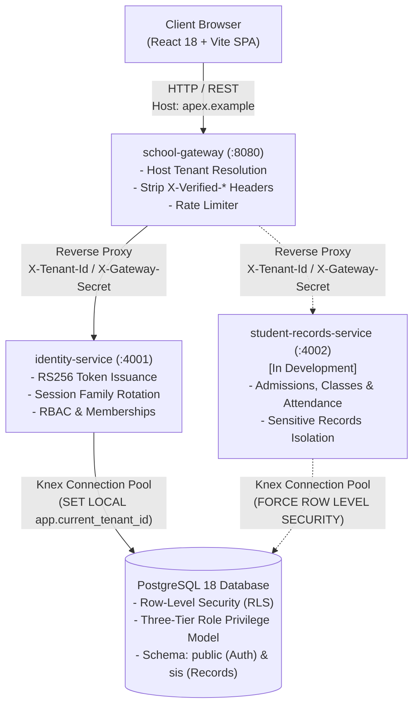

# SchoolEMS — Multi-Tenant School Management Platform (SaaS)

[](https://nodejs.org/)
[](https://react.dev/)
[-336791.svg)](https://www.postgresql.org/)
[](docs/phase-1/04-authentication-and-jwt.md)
[-brightgreen.svg)](#k-testing-and-quality-assurance)
[](docs/school-management-migration/04-target-school-saas-architecture.md)
[-purple.svg)](#h-local-development-setup)

A commercial, multi-tenant software-as-a-service (SaaS) platform engineered to unify academic administration, student information, institutional governance, and family communication across independent K-12 schools, multi-campus institutions, and regional educational trusts.

---

## Table of Contents

- [A. Product Introduction](#a-product-introduction)
- [B. Product Overview](#b-product-overview)
- [C. Core Capabilities & Feature Status](#c-core-capabilities--feature-status)
- [D. User Roles & Access Governance](#d-user-roles--access-governance)
- [E. Technology Architecture](#e-technology-architecture)
- [F. High-Level Architecture](#f-high-level-architecture)
- [G. Repository Structure](#g-repository-structure)
- [H. Local Development Setup](#h-local-development-setup)
- [I. Environment Configuration](#i-environment-configuration)
- [J. Security & Data Protection Controls](#j-security--data-protection-controls)
- [K. Testing & Quality Assurance](#k-testing--quality-assurance)
- [L. Project Status & Roadmap](#l-project-status--roadmap)
- [M. Technical Documentation Index](#m-technical-documentation-index)
- [N. Licensing & Commercial Inquiries](#n-licensing--commercial-inquiries)

---

## A. Product Introduction

- **Product Name:** SchoolEMS (Multi-Tenant School Management Platform SaaS)
- **Description:** A commercial, multi-tenant educational operations platform designed to streamline administration, student lifecycles, and academic records across educational trusts and independent campuses.
- **Problem Statement:** Traditional school management systems frequently rely on brittle single-tenant installations or insecure application-level filtering (`WHERE tenant_id = ?`). These approaches result in high infrastructure maintenance overhead, administrative fragmentation, and significant cross-institution data exposure risks whenever queries or ORM mappers lack explicit scoping.
- **Target Customer Segment:** Multi-campus educational federations, private K-12 school networks, and independent academic institutions requiring strict institutional isolation and hierarchical administration.
- **Primary User Groups:** School Administrators, Campus Principals, Teachers, Enrolled Students, Parents and Guardians, Bursars / Accountants, and Platform SuperAdmins.

---

## B. Product Overview

SchoolEMS provides a single operational spine for educational institutions, eliminating disparate spreadsheets, standalone attendance tracking, and disconnected billing tools. 

### Key Architectural Tenets
1. **Engine-Level Multi-Tenancy:** Multi-tenancy is enforced directly inside the PostgreSQL database engine via native Row-Level Security (RLS). Queries missing tenant context fail closed and return zero rows.
2. **Branch Hierarchy:** Supports multi-campus trusts (e.g. Main Campus, North Campus) sharing a single institutional account, while maintaining branch-specific class sections, staff assignments, and attendance registers.
3. **Cryptographic Identity:** Uses asymmetric RSA-2048 keypairs (`RS256`), automated refresh-token family rotation, and tamper-evident append-only audit logging.
4. **Cloud-Independent, Local-First Runtime:** The entire development and test workflow runs locally on standard developer workstations (Windows 11 / WSL / Linux) with zero cloud vendor dependencies.

---

## C. Core Capabilities & Feature Status

Capabilities are classified based on the actual codebase implementation and approved specifications:

| Functional Module | Status | Details & Implementation Baseline |
| :--- | :---: | :--- |
| **Multi-Tenant Onboarding & Domains** | **Implemented** | Tenant registration, branch creation, and host/subdomain domain resolution (`public.tenants`, `public.branches`, `public.tenant_domains`). |
| **Authentication & IAM** | **Implemented** | Asymmetric RS256 JWT issuance, key rotation, refresh-token family replay detection, and session management (`services/auth-service`). |
| **Role-Based Access Control (RBAC)** | **Implemented** | Hierarchical 7-role permission matrix, cross-tenant protection, and privilege escalation prevention (`public.roles`, `public.user_tenant_memberships`). |
| **API Gateway Ingress** | **Implemented** | Host header parsing, reverse proxy routing, header sanitization (stripping client `X-Verified-*`), and rate limiting (`services/gateway`). |
| **Audit Logging** | **Implemented** | Append-only database audit log recording security and administrative actions (`public.audit_logs`). |
| **Academic Calendar & Terms** | *In Development* | Academic years, terms, and session date configuration (Approved in Phase 2 SIS architecture; target schema `sis.academic_years`). |
| **Class & Section Management** | *In Development* | Grade classes, sections with maximum capacity thresholds, subject allocations, and class teacher mappings (`sis.classes`, `sis.sections`). |
| **Student Admissions & Registry** | *In Development* | Application intake, status transitions, demographics, and atomic sequential admission numbering (`sis.students`, `sis.admission_number_sequences`). |
| **Safeguarding & Health Isolation** | *In Development* | Segregated health records and restricted safeguarding notes with role-scoped access control (`sis.student_health_records`, `sis.student_safeguarding_records`). |
| **Guardian Network & DPDP Consent** | *In Development* | Child-specific guardian mapping, custody status tracking, and verifiable parental consent records (`sis.guardians`, `sis.guardian_consents`). |
| **Classroom Attendance Engine** | *In Development* | Section-level daily attendance capture (present, absent, late, excused, half-day) and student summary rollups (`sis.student_attendance`). |
| **School Announcements** | *In Development* | Institutional and branch broadcast notices filtered by tenant, campus, and target role (`sis.announcements`). |
| **Timetable & Scheduling** | *Planned* | Period grids and teacher allocation collision prevention (Stage 1 Release 2 / Phase 3). |
| **Homework & Assignments** | *Planned* | Teacher assignment publishing and student submission tracking (Stage 1 Release 2). |
| **Fee Structures & Collection** | *Planned* | Fee heads, scheduled collection, payment logging, and sequential receipt issuance (Stage 1 Release 2 / Phase 6). |
| **Dedicated Role Portals** | *Planned* | Specialized web portals for Teachers, Students, and Multi-Child Parents (Stage 1 Release 2 / Phase 7). |

> **Deliberately Deferred Capabilities (Post-MVP Roadmap):**  
> External SMS/WhatsApp gateways, third-party payment gateways (Stripe/Razorpay), complex grading scales/report card engines (Phase 5), fleet/bus tracking (Phase 8), and native mobile application binaries are scheduled for later commercial phases.

---

## D. User Roles & Access Governance

SchoolEMS defines 7 canonical personas with strictly separated operational boundaries enforced at the API Gateway, microservice route handlers, and database RLS layers:

```
[ Platform SuperAdmin ] ──────────► SaaS platform operator; manages tenants & platform health
          │
          ▼
    [ SchoolAdmin ] ──────────────► Institutional manager; manages school branches, staff & configuration
          │
          ▼
     [ Principal ] ───────────────► Campus academic head; oversees classes, teachers & safeguarding
          │
          ├────────────────────────┬────────────────────────┐
          ▼                        ▼                        ▼
     [ Teacher ]             [ Accountant ]           [ FrontDesk ]
  Classroom educator       Bursar / Fee officer     Admissions & reception
          │
          ├────────────────────────┐
          ▼                        ▼
     [ Student ]               [ Parent ]
    Learner portal        Custodial child records
```

### Governance & Privilege Escalation Defenses
- **Strict Delegation Guardrails:** A `SchoolAdmin` cannot invite or assign a `Platform SuperAdmin`. A `Principal` cannot grant `SchoolAdmin` or `SuperAdmin` privileges.
- **Anti-Self-Promotion:** Users cannot elevate their own role or assign unauthorized permission flags (`403 Forbidden`).
- **Data Scoping:** Parents have access exclusively to their verified linked children; permission for Child A conveys zero access to Child B.
- **Safeguarding Protection:** Platform SuperAdmins, accountants, and teachers are strictly denied access to sensitive child safeguarding files.

---

## E. Technology Architecture

The application is built on modern web and database technologies configured for local-first reliability:

- **Frontend Application:** React 18 SPA built with Vite, React Router 6, Tailwind CSS, and accessible UI components (`frontend`).
- **API Gateway:** Node.js 20+ and Express reverse proxy utilizing `http-proxy-middleware`, custom host-to-tenant mapping, and request header sanitization (`services/gateway`).
- **Backend Microservices:** Node.js 20+ LTS modular Express microservices adhering to Domain-Driven Design (DDD) principles (`services/auth-service`).
- **Database Engine:** PostgreSQL 18+ (tested on PostgreSQL 18.6 in WSL / Ubuntu) with native Row-Level Security (RLS) enabled on all tenant data tables.
- **Database Migration & Querying:** Knex.js SQL query builder with deterministic forward and rollback migration capabilities (`knexfile.js`).
- **Cryptographic Security:** Asymmetric RSA-2048 signing (`jsonwebtoken`) with `RS256`, SHA-256 token hashing, and salted password encryption (`bcryptjs`).
- **Local Developer Orchestration:** Windows PowerShell (`start-dev.ps1`) and Linux/macOS Bash (`start-dev.sh`).
- **Automated Test Harness:** Node.js native test runner (`node:test`) requiring zero third-party testing dependencies.

> [!NOTE]
> SchoolEMS requires **zero active AWS services or cloud vendor infrastructure** for development, demonstration, and automated test execution. The platform is designed to be cloud-portable.

---

## F. High-Level Architecture



---

## G. Repository Structure

```text
JuneAWSAIOpsProj-main/
├── start-dev.ps1                 # One-click Windows PowerShell local launcher
├── start-dev.sh                  # One-click Linux / macOS / WSL local launcher
├── docker-compose.yml            # Local container environment definition
├── CLAUDE.md                     # Engineering standards & development conventions
├── LOCAL-SETUP.md                # Step-by-step local workstation onboarding guide
├── docs/                         # Formal engineering specifications & audit records
│   ├── architecture/             # Milestone 0 system architecture & API mapping
│   ├── database/                 # Milestone 0 physical database design, ERDs & tests
│   ├── research/                 # Source-backed technical research studies
│   ├── ENGINEERING_STANDARDS.md  # Permanent engineering charter & Definition of Done
│   ├── phase-1/                  # Identity foundation, database schema & security audits
│   ├── phase-2/                  # Student Information System (SIS) domain & architecture
│   ├── product/                  # Stage 1 MVP product scope & phased implementation roadmaps
│   ├── ui-ux/                    # UI design brief, design system & screen specifications
│   └── legacy/                   # Historical reference documentation and guides
├── frontend/                     # React 18 + Vite Frontend Application (Port 5173)
│   ├── src/                      # UI components, contexts, and portal views
│   └── package.json              # Frontend package configuration
├── services/                     # Backend Microservices Workspace
│   ├── common/                   # Shared core libraries (auth.js, db.js, service.js)
│   ├── gateway/                  # API Gateway (Port 8080)
│   ├── auth-service/             # Identity & Access Management Service (Port 4001)
│   │   ├── migrations/           # Knex migrations (01 through 07)
│   │   └── seeds/                # Bootstrap & demonstration seeding scripts
│   ├── test/                     # Automated test suite (node:test)
│   ├── .env.example              # Environment configuration baseline
│   └── package.json              # Backend scripts and dependencies
└── archive/                      # Historical legacy project archives
    ├── legacy-aiops-assistant/   # Preserved legacy AIOps assistant
    ├── legacy-infrastructure/    # Preserved legacy Terraform AWS infrastructure
    ├── legacy-gitops/            # Preserved legacy ArgoCD K8s manifests
    ├── legacy-references/        # Preserved reference links
    ├── legacy-scripts/           # Preserved legacy operational scripts
    └── legacy-ecommerce-services/# Preserved legacy e-commerce services & stubs
```

---

## H. Local Development Setup

### Prerequisites
- **Node.js:** `>= 20.0.0 LTS`
- **npm:** `>= 10.0.0`
- **PostgreSQL:** `>= 16.0` (Running locally on port `5432` or via WSL Ubuntu)

### Option 1: One-Click Launch

#### Windows (PowerShell)
```powershell
.\start-dev.ps1
```

#### Linux / macOS / WSL (Bash)
```bash
chmod +x ./start-dev.sh
./start-dev.sh
```

The launcher script validates the PostgreSQL daemon, applies pending migrations, and launches the API Gateway (`:8080`), Identity Service (`:4001`), and Vite Frontend UI (`:5173`) concurrently.

---

### Option 2: Manual Step-by-Step Setup

#### 1. Configure Backend Environment
```bash
cd services
cp .env.example .env
```

#### 2. Execute Database Migrations
```bash
npm run migrate
```
Applies all foundational migrations:
1. `create_tenants_and_branches`
2. `create_users_and_memberships`
3. `create_rbac_tables`
4. `create_domains_and_sessions`
5. `create_audit_logs`
6. `enable_rls_and_policies`
7. `create_platform_admins`

#### 3. Seed Demonstration Data
```bash
# Seed demonstration schools (Apex Academy and Horizon International)
npm run seed:demo-schools

# (Optional) Seed platform SuperAdmin account
npm run seed:superadmin
```

#### 4. Launch Backend & Frontend
```bash
# Launch backend services (Gateway + Auth Service)
npm run dev:backend

# In a separate terminal, launch the frontend UI
cd ../frontend
npm run dev
```

---

### Service Ports & Local Endpoints

| Service | Local Address | Health Check / Entrypoint |
| :--- | :--- | :--- |
| **Frontend Web UI** | `http://localhost:5173` | Interactive Web Application |
| **API Gateway** | `http://localhost:8080` | `http://localhost:8080/api/health` |
| **Identity Service** | `http://localhost:4001` | `http://localhost:4001/health` |
| **PostgreSQL Database** | `127.0.0.1:5432` | Database: `auth_db` |

---

### Pre-Seeded Demonstration Accounts

When `npm run seed:demo-schools` is executed, the following pre-configured demonstration accounts are available (Default password: `DemoPassword@2026`):

| Institution | Persona | Email | Domain Context |
| :--- | :--- | :--- | :--- |
| **Apex Academy** | School Admin | `admin@apex.example` | `apex.example` |
| **Apex Academy** | Teacher | `teacher@apex.example` | `apex.example` |
| **Apex Academy** | Student | `student@apex.example` | `apex.example` |
| **Horizon International** | School Admin | `admin@horizon.example` | `horizon.example` |
| **Platform-Wide** | SuperAdmin | `superadmin@schoolsaas.internal` | Platform Root / Global |

---

## I. Environment Configuration

Environment variables are configured in `services/.env`. Use `.env.example` as the authoritative template:

| Variable | Description | Default / Example Value | Required? |
| :--- | :--- | :--- | :---: |
| `NODE_ENV` | Application runtime environment | `development` | Yes |
| `PGHOST` | PostgreSQL server host address | `127.0.0.1` | Yes |
| `PGPORT` | PostgreSQL server port | `5432` | Yes |
| `PGUSER` | Database runtime connection user | `postgres` (or `school_app_user`) | Yes |
| `PGPASSWORD` | Database connection password | *(Set locally)* | Yes |
| `DB_NAME` | Primary application database name | `auth_db` | Yes |
| `JWT_SECRET` | Fallback signing secret | *(Development default)* | Yes |
| `GATEWAY_INTERNAL_SECRET` | Shared secret for gateway-to-service integrity | `internal-gateway-secret-dev-2026` | Yes |
| `ALLOW_HEADER_TENANT_RESOLVER`| Allows `X-Tenant-Domain` header override in dev | `true` | No |
| `AUTH_RATE_LIMIT_PER_MIN` | Ingress rate limit per client IP | `100` | No |
| `GATEWAY_PORT` | Public port for API Gateway reverse proxy | `8080` | No |

> [!WARNING]
> Never commit real `.env` files, production credentials, RSA private keys, or passwords to version control. Production deployments must supply secrets through secure environment injection.

---

## J. Security & Data Protection Controls

- **Database Engine RLS:** All tenant tables enforce `FORCE ROW LEVEL SECURITY`. Application connections initialize the tenant context on every transaction:
  ```sql
  SET LOCAL app.current_tenant_id = '01912345-6789-7abc-def0-123456789abc';
  ```
  Missing or malformed tenant identifiers cause the policy to fail closed, returning zero rows.
- **Three-Tier Database Privilege Model:**
  - `school_schema_owner` (`NOLOGIN`, `NOBYPASSRLS`): Owns all tables, sequences, and RLS policies.
  - `school_migration_user` (`LOGIN`): Can assume schema owner during automated migration tasks only.
  - `school_app_user` (`LOGIN`, `NOBYPASSRLS`): Unprivileged runtime user with no DDL privileges and no ability to bypass RLS.
- **Asymmetric RS256 Authentication:** Access tokens are signed with RSA-2048 private keys and verified with public keys. Tokens carry a `kid` (Key ID) header supporting zero-downtime key rotation.
- **Refresh Token Family Rotation:** Refresh tokens are cryptographically random strings stored as SHA-256 hashes. Presenting an expired or reused refresh token revokes the entire token family immediately.
- **API Gateway Defenses:** Automatically strips incoming client `X-Verified-*` headers case-insensitively and attaches an internal `X-Gateway-Secret` before proxying requests to backend services.
- **Audit Trails:** Security and administrative operations record actor, tenant, IP address, and payload metadata to `public.audit_logs`.

---

## K. Testing & Quality Assurance

The platform uses Node.js's native test runner (`node:test`) for fast, zero-dependency automated verification:

```bash
cd services
npm test
```

### Verified Test Coverage
- **RS256 Asymmetric Cryptography:** RSA keypair generation, algorithm confusion defenses (rejection of HS256), UUID format enforcement, claim roundtrips, and key rotation.
- **Database Migrations & Rollback:** Clean execution of migrations 01–07 under schema owner, idempotency, and complete rollback safety.
- **Row-Level Security Verification:** Real database multi-tenant data isolation tests connecting as unprivileged `school_app_user`.
- **Negative Security & Privilege Escalation:** Rejection of root login without tenant context, prevention of administrative privilege escalation, keypair mismatch detection, and gateway header stripping.
- **API Integration & Session Lifecycle:** Tenant onboarding, campus creation, user invitation, and refresh token family revocation.

*Note: For testing against PostgreSQL inside WSL, use `npm run test:wsl`.*

---

## L. Project Status & Roadmap

```
┌────────────────────────────────────────────────────────────────────────────────────────┐
│                                 DELIVERY STATUS OVERVIEW                               │
├──────────┬──────────────────────────────────────────┬──────────────┬───────────────────┤
│ Phase    │ Scope & Deliverables                     │ Status       │ Verification      │
├──────────┼──────────────────────────────────────────┼──────────────┼───────────────────┤
│ Phase 1  │ Multi-Tenant Foundation & IAM            │ Completed    │ Automated Tests   │
│ Phase 2  │ Student Information System (SIS)         │ Approved     │ Design Accepted   │
│ Stage 1  │ MVP Pilot: Core Academic Operations      │ In Progress  │ Releases 1 & 2    │
│ Phase 3  │ Timetable Engine & Academic Scheduling   │ Planned      │ Post-MVP Scope    │
│ Phase 4  │ Attendance Management & Hardware Intake  │ Planned      │ Post-MVP Scope    │
│ Phase 5  │ Examination, Grading & Report Cards      │ Planned      │ Post-MVP Scope    │
│ Phase 6  │ Fee Management & Bursar Operations       │ Planned      │ Post-MVP Scope    │
│ Phase 7  │ Role Portals (Teacher, Student, Parent)  │ Planned      │ Post-MVP Scope    │
│ Phase 8  │ Transport, Hostel & Operations           │ Planned      │ Post-MVP Scope    │
└──────────┴──────────────────────────────────────────┴──────────────┴───────────────────┘
```

---

## M. Technical Documentation Index

Comprehensive design specifications, engineering governance, and architecture blueprints are maintained in the repository:

### Core Governance & Specifications
- [Engineering Standards & Definition of Done](docs/ENGINEERING_STANDARDS.md) — Mandatory code quality charter, architectural patterns, and DoD.
- [Phase 1 Architecture Specification](docs/phase-1/01-phase-1-architecture.md) — Multi-tenant foundation blueprint.
- [Database Schema Specification](docs/phase-1/02-database-schema.md) — Table definitions, constraints, and migrations.
- [Tenant Isolation Design](docs/phase-1/03-tenant-isolation-design.md) — PostgreSQL RLS policies and session context variables.
- [Authentication & JWT Architecture](docs/phase-1/04-authentication-and-jwt.md) — RS256 token signing and refresh rotation.
- [RBAC Permissions Matrix](docs/phase-1/05-rbac-permissions-matrix.md) — Granular permissions across 7 roles.
- [Security Controls & Hardening](docs/phase-1/07-security-controls.md) — Gateway defenses and tamper-evident audit logs.
- [Post-Remediation Security Verification](docs/phase-1/16-post-remediation-verification.md) — Verification report approving Phase 2.

### Student Information System (SIS) & Product Architecture
- [Phase 2 SIS Domain Overview](docs/phase-2/01-sis-domain-overview.md) — Student Information System modular domain architecture.
- [Student Data Model](docs/phase-2/02-student-data-model.md) — Demographic, status, and sequential numbering schema.
- [Academic Structure Specification](docs/phase-2/03-academic-structure.md) — Academic years, terms, classes, sections, and subjects.
- [Parent & Guardian Data Model](docs/phase-2/04-parent-guardian-model.md) — Custody tracking and verifiable parental consent.
- [Admission Workflow Specification](docs/phase-2/05-admission-workflow.md) — Concurrency-safe applicant intake and enrollment.
- [Tenant & Branch Isolation in SIS](docs/phase-2/06-tenant-branch-isolation.md) — Cross-schema RLS policies for `sis`.
- [Stage 1 MVP Product Scope](docs/product/stage-1-mvp-scope.md) — Functional boundary and release definitions.
- [Stage 1 Implementation Roadmap](docs/product/stage-1-implementation-roadmap.md) — Implementation schedule and milestone targets.
- [UI/UX Design System & Screen Inventory](docs/ui-ux/01-product-design-brief.md) — Visual design tokens and responsive screen inventory.

---

## N. Licensing & Commercial Inquiries

SchoolEMS is proprietary commercial software currently under active development for educational institutions.  
Commercial deployment, pilot onboarding, and licensing inquiries are managed under private institutional agreements.

For security vulnerability disclosures or multi-tenant isolation inquiries, please review [docs/phase-1/07-security-controls.md](docs/phase-1/07-security-controls.md).
