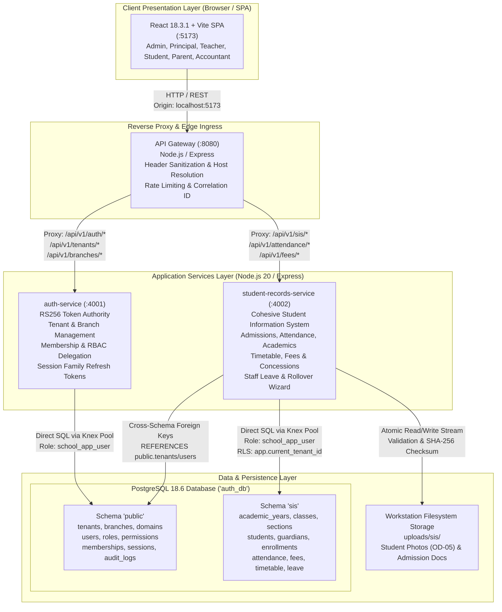

# Document 01: Complete Technical System Architecture

**Document Status:** TECHNICAL SPECIFICATION — APPROVED BASELINE  
**Classification:** System Architecture & Runtime Infrastructure  
**Target Pilot Scope:** Initial Onboarding & Demonstration for 1–2 Independent Schools (e.g., Apex Academy, Horizon International)  
**Runtime Environment:** 100% Local-First (Windows 11 / WSL Ubuntu, Node.js 20+, PostgreSQL 18.6)  
**Cloud Infrastructure:** Zero Cloud / AWS Dependencies (Local Developer Workstation Execution)  
**Date:** March 2026  
**Author:** Principal Enterprise Systems Architect & Lead Security Engineer  

---

## 1. System Overview & Boundaries

### 1.1 Product Purpose
SchoolEMS is a multi-tenant School Management Software-as-a-Service (SaaS) engineered for independent and multi-campus educational institutions. The platform is designed to pilot and demonstrate live operations for 1–2 schools without artificial limits on student cohorts, staff rosters, or academic records.

### 1.2 System Boundaries & Non-Goals
1. **Core Operational Boundary:** The system manages core institutional operations: school and campus configuration, academic years, classes, student admissions and demographics, guardian kinship records, daily attendance registers, timetables, homework assignments, student fee collection with concession workflows, in-app announcements, and staff leave requests.
2. **Explicit Non-Goals for Stage 1:**
   - No external payment gateway integrations (Razorpay, Stripe) — all fee collections record direct institutional payments (Cash, Cheque, Bank Transfer, POS/DD) with manual verification.
   - No external SMS, WhatsApp, or email transit providers (Twilio, SendGrid) — communications are strictly delivered via the in-app announcement and portal alert mechanisms.
   - No third-party biometric device drivers or RFID hardware — attendance marking is manual classroom roll-call via the teacher interface with offline connection resilience.
   - No paid cloud storage services (AWS S3, Google Cloud Storage) — files reside in workstation local filesystem storage (`uploads/sis/`) with strict DB metadata linkage and access checks.

### 1.3 Tenant & Branch Organizational Hierarchy
SchoolEMS models educational entities using a strict three-tier organizational hierarchy:

```
┌────────────────────────────────────────────────────────┐
│               PLATFORM OPERATOR LAYER                  │
│       Managed by: Platform SuperAdmin                  │
│       Scope: Global (Cross-tenant provisioning)        │
└──────────────────────────┬─────────────────────────────┘
                           │ 1:N
                           ▼
┌────────────────────────────────────────────────────────┐
│                   TENANT LAYER                         │
│       e.g., "Apex Educational Trust"                   │
│       Managed by: School Admin                         │
│       Scope: All Campuses & Institutional Configuration│
└──────────────────────────┬─────────────────────────────┘
                           │ 1:N
                           ▼
┌────────────────────────────────────────────────────────┐
│                   BRANCH LAYER                         │
│       e.g., "Apex Academy — City Campus"               │
│       Managed by: Principal, Head of School            │
│       Scope: Campus Cohorts, Classrooms, Faculty, SIS  │
└────────────────────────────────────────────────────────┘
```

- **Platform Tier:** Governs tenant provisioning, custom domain routing, and platform-wide health monitoring. Platform SuperAdmins cannot access student health or safeguarding files.
- **Tenant Tier (`public.tenants`):** An independent legal educational organization or governing trust. Master fee structures, academic calendar templates, institution-wide policies, and system memberships belong to the tenant.
- **Branch Tier (`public.branches`):** A physical campus facility operating under a tenant. Grade classes, classroom sections, physical subject classrooms, local student admissions, timetables, daily attendance sessions, and campus-specific staff belong to a specific branch.

### 1.4 Release 1 vs. Release 2 Functional Boundaries

| Functional Domain | Release 1: Core Operations | Release 2: Daily School Experience |
| :--- | :--- | :--- |
| **Institutional Setup** | School & branch setup, custom domain mapping, academic years, terms, classes, sections, subjects, teacher assignments. | Academic calendar scheduling, holidays, and examination period markers. |
| **Identity & Access** | RS256 JWT auth, role delegation, user invites, session management, audit logging. | Role-specific portals (Teacher, Student, Parent with Child Selector). |
| **Student Information** | Admission application pipeline, student profiles, voluntary national ID salted hash, student photo upload (OD-05), segregated health & safeguarding. | Student bulk import (CSV/XLSX), cohort progression, Academic Rollover Review Wizard (OD-01). |
| **Family Network** | Guardian profiles, student-guardian kinship mappings, custody alerts, DPDP Section 9 digital consents. | Parent multi-child context switcher pill in global portal header (OD-03). |
| **Attendance Engine** | Section daily roll-call (AM/PM/Period), offline preservation in-memory (OD-02), attendance audit trail. | Aggregate monthly attendance reports, chronic absence alerts, leave integration. |
| **Academics & Operations** | In-app announcements with role audience targeting. | Class & teacher weekly timetables, homework assignments & student submissions. |
| **Finance & HR** | *Not in Release 1 scope.* | Fee structures, student fee allocations, cashier collections, receipt numbering, concession categories & Principal waivers (OD-04), outstanding balance tracking, staff leave requests & approvals. |

---

## 2. Logical Architecture

SchoolEMS is built on a clean, decoupled, service-oriented architecture designed to execute seamlessly on a single developer workstation or containerized local environment:



### 2.1 Component Responsibilities
1. **Frontend Single Page Application (`projects/school-management/frontend`):**
   - Port: `5173` (Vite dev server) or served static bundle via Nginx.
   - Built on React 18.3.1, vanilla CSS variables (`styles.css`), and accessible semantic HTML.
   - Features role-tailored dashboards and navigation trees for all 7 user personas.
   - Manages client-side access token expiration, automatic silent refresh, and offline attendance cache.
2. **API Gateway Service (`projects/school-management/services/gateway`):**
   - Port: `8080` (Express-based reverse proxy using `http-proxy-middleware`).
   - The sole entry point exposed to browsers.
   - Ingress security: Sanitizes incoming headers, strips untrusted `X-Forwarded-*` and spoofed `X-Verified-*` headers, injects correlation `X-Request-Id` and internal service authentication `X-Gateway-Secret`.
   - Resolves tenant domain from the incoming `Host` header or authenticated JWT claims.
3. **Authentication & Identity Service (`projects/school-management/services/auth-service`):**
   - Port: `4001`.
   - Issues and cryptographically verifies RS256 asymmetric JWT access tokens with embedded tenant and branch context.
   - Governs user identity, credentials (Argon2id password hashing), multi-tenant memberships, session family tokens with automatic reuse detection, and platform administration.
4. **Student Information System Service (`projects/school-management/services/student-records-service`):**
   - Port: `4002`.
   - Implemented as a single, cohesive, high-cohesion SIS backend service.
   - Manages all Phase 2 business domains: Admissions, Students, Guardians, Cohort Enrollments, Attendance Registers, Timetables, Homework, Fee Structures, Receipts, Concessions, Staff Leave, and Academic Rollover.
   - Connects to PostgreSQL database `auth_db` under schema `sis` with connection-level Row-Level Security (RLS) enforcement.
5. **PostgreSQL Relational Database (`auth_db`):**
   - PostgreSQL 18.6 running in local workstation WSL2 Ubuntu environment.
   - Port: `5432`.
   - Single unified physical database `auth_db` partitioned into two logical schemas:
     - `public`: Phase 1 Identity, Authentication, and Platform entities.
     - `sis`: Phase 2 Student Information System entities.
6. **Local Filesystem Storage:**
   - Path: `projects/school-management/services/student-records-service/uploads/sis/`.
   - Stores student portrait photographs (OD-05, max 2MB) and uploaded admission documents.
   - Zero cloud/S3 dependencies; files are served exclusively through authorized streaming endpoints verifying tenant ownership.

---

## 3. Runtime Architecture & Execution Lifecycle

### 3.1 Application Processes and Port Allocations
Every runtime process in the SchoolEMS platform operates on an explicitly defined, non-conflicting local port:

| Process / Service | Runtime Engine | Standard Port | Working Directory | Environment Variables |
| :--- | :--- | :---: | :--- | :--- |
| **API Gateway** | Node.js 20.x | `8080` | `projects/school-management/services/gateway` | `PORT=8080`, `AUTH_SERVICE_URL=http://localhost:4001`, `SIS_SERVICE_URL=http://localhost:4002` |
| **Auth Service** | Node.js 20.x | `4001` | `projects/school-management/services/auth-service` | `PORT=4001`, `DB_NAME=auth_db`, `PGUSER=school_app_user`, `JWT_PRIVATE_KEY=...` |
| **SIS Service** | Node.js 20.x | `4002` | `projects/school-management/services/student-records-service` | `PORT=4002`, `DB_NAME=auth_db`, `PGUSER=school_app_user`, `JWT_PUBLIC_KEY=...` |
| **Frontend UI** | Vite / React 18 | `5173` | `projects/school-management/frontend` | `VITE_API_URL=http://localhost:8080` |
| **PostgreSQL DB** | PostgreSQL 18.6 | `5432` | Local WSL Ubuntu `/etc/postgresql/18/main` | `PGHOST=127.0.0.1`, `PGPORT=5432`, `PGDATABASE=auth_db` |

### 3.2 End-to-End Request and Response Flow
1. **Browser Request:** The browser sends an HTTPS/HTTP request to `http://localhost:8080/api/v1/sis/students?class_id=...` with header `Authorization: Bearer <RS256_JWT>` and `Host: apex.schoolsaas.local:8080`.
2. **Gateway Processing:**
   - The Gateway intercepts the request.
   - Generates or preserves `X-Request-Id: <UUIDv4>`.
   - Strips client-supplied `X-Gateway-Secret`, `X-Tenant-Id`, `X-Forwarded-Host`, and all `X-Verified-*` headers.
   - Injects `X-Gateway-Secret: <shared_internal_secret>` and `X-Forwarded-Prefix: /api`.
   - Proxies the sanitized request to the SIS service at `http://localhost:4002/v1/sis/students?class_id=...`.
3. **SIS Service Ingress & Authentication:**
   - Validates that `X-Gateway-Secret` matches internal configuration (blocking direct bypassing of the gateway).
   - Middleware `requireSchoolAuth` verifies the RS256 token using the trusted public key:
     - Validates cryptographic signature, expiry (`exp`), issuer (`https://auth.schoolsaas.com`), and audience (`schoolsaas-api`).
     - Extracts claims: `sub` (User ID), `tenant_id`, `branch_id`, `membership_id`, and `roles`.
4. **Database Transaction & RLS Context Binding:**
   - The service borrows a connection from the PostgreSQL pool (`school_app_user`).
   - Executes `withTenantContext(pool, tenant_id, async (client) => { ... })`:
     - Emits `BEGIN`.
     - Emits `SELECT set_config('app.current_tenant_id', '<tenant_uuid>', true)`.
     - Executes business query: `SELECT * FROM sis.students WHERE branch_id = $1 ...`.
     - PostgreSQL engine evaluates Row-Level Security policies on `sis.students`: `tenant_id = NULLIF(current_setting('app.current_tenant_id', true), '')::uuid`.
     - Emits `COMMIT`.
     - Finally resets `SELECT set_config('app.current_tenant_id', '', false)`.
5. **Response Serialization:**
   - The service formats standard JSON response: `{ "success": true, "data": [...], "meta": { "request_id": "...", "timestamp": "..." } }`.
   - The Gateway passes the response back to the client with hardened security headers (`X-Content-Type-Options: nosniff`, `X-Frame-Options: DENY`).

---

## 4. Comprehensive Authorization & Role Purview Architecture

SchoolEMS enforces strict Role-Based Access Control (RBAC) at two distinct layers:
1. **API Middleware Layer:** Coarse-grained and branch-scoped permission gates checking claims in the RS256 JWT.
2. **Database Layer:** Fine-grained Row-Level Security (RLS) guaranteeing data isolation by tenant and relational foreign keys.

### 4.1 Persona Authorization & Data Purview Matrix

| Persona | Permitted Operations | Restricted / Prohibited Access | Branch Scope Enforcement |
| :--- | :--- | :--- | :--- |
| **Platform SuperAdmin** | Provision new school tenants, assign primary tenant domains, inspect platform aggregated health. | Strictly prohibited from viewing student demographics, grades, fees, health records, or safeguarding files. | Global (Platform-wide tenant registry only). |
| **School Admin** | Configure tenant metadata, branches, academic years, fee structures, staff memberships, broadcast tenant-wide announcements. | Prohibited from editing student safeguarding case notes or altering marked attendance older than lock window. | Tenant-wide (can access and manage all branches under own tenant). |
| **Principal** | Manage branch classes, sections, teacher allocations, approve admission applications, approve fee concessions (OD-04), approve staff leave. | Restricted to assigned campus branch. Prohibited from cross-branch viewing or altering tenant-level licensing. | Branch-scoped (access locked to `claims.branch_id`). |
| **Teacher** | Mark/edit daily attendance for assigned sections (within same-day edit window), create assignments, view student allergy emergency flags. | Prohibited from viewing student full medical histories, safeguarding notes, tuition fee amounts, or other teachers' payroll/leave. | Section/Subject-scoped (checked via `sis.section_subject_teachers`). |
| **Student** | View personal daily timetable, personal attendance summary, assigned homework, personal marks, institutional announcements. | Prohibited from viewing other students' records, marking attendance, or accessing administrative tools. | Self-scoped (checked via `sis.student_enrollments.student_id = claims.sub`). |
| **Parent / Guardian** | View attendance, fee invoices, receipts, and announcements strictly for children where legal guardianship is mapped in `sis.student_guardians`. | Prohibited from viewing any other children, classroom registers, or other parents' financial records. | Linked-children-scoped (checked via `sis.student_guardians.guardian_id`). |
| **Accountant** | Define fee categories, record cashier payments, print official receipts, approve standard concessions, manage collection ledgers. | Strictly prohibited from viewing student medical conditions, safeguarding records, or academic exam grading sheets. | Branch / Tenant-financial (checked via `accountant` role claim). |

---

## 5. Multi-Tenant Isolation & Row-Level Security (RLS)

SchoolEMS enforces multi-tenancy at the kernel level of PostgreSQL 18.6 using fail-closed Row-Level Security.

### 5.1 Fail-Closed RLS Mechanics
All tables in the `sis` schema contain a mandatory, non-nullable column `tenant_id UUID REFERENCES public.tenants(id)`.
Row-Level Security is explicitly enabled and forced:

```sql
ALTER TABLE sis.<table_name> ENABLE ROW LEVEL SECURITY;
ALTER TABLE sis.<table_name> FORCE ROW LEVEL SECURITY;

CREATE POLICY tenant_isolation_<table_name> ON sis.<table_name>
  FOR ALL
  TO school_app_user
  USING (tenant_id = NULLIF(current_setting('app.current_tenant_id', true), '')::uuid)
  WITH CHECK (tenant_id = NULLIF(current_setting('app.current_tenant_id', true), '')::uuid);
```

### 5.2 RLS Execution Guarantees
1. **Unprivileged Runtime Identity:** Node.js connects as `school_app_user`, which possesses `NOSUPERUSER` and `NOBYPASSRLS`. Even table owners cannot bypass RLS when `FORCE ROW LEVEL SECURITY` is set.
2. **Fail-Closed on Unset Context:** If a developer query executes without setting `app.current_tenant_id`, `current_setting('app.current_tenant_id', true)` evaluates to `''`. `NULLIF('', '')` evaluates to `NULL`. The comparison `tenant_id = NULL` evaluates to `UNKNOWN`/`FALSE` in SQL three-valued logic. **The query returns 0 rows and fails closed.**
3. **Transaction-Local Setting:** `SELECT set_config('app.current_tenant_id', $1, true)` passes `true` as the third parameter (`is_local`), scoping the setting strictly to the current database transaction block. When the transaction commits or rolls back, PostgreSQL automatically clears the variable.
4. **Connection Pool Safety:** To prevent session variable pollution if a connection is returned to the Knex/pg pool without closing a transaction, the `finally` block of `withTenantContext` explicitly executes `SELECT set_config('app.current_tenant_id', '', false)` before releasing the client back to the pool.

---

## 6. Local-First File Storage Architecture

In accordance with Stage 1 constraints, SchoolEMS avoids paid object storage (AWS S3) and implements a secure, local-first streaming storage architecture.

### 6.1 Storage Directory Structure
Files are organized hierarchically by tenant and entity type on the workstation filesystem:

```
projects/school-management/services/student-records-service/uploads/sis/
├── <tenant_id_1>/
│   ├── photos/
│   │   ├── <student_id_a>_<timestamp>.jpg
│   │   └── <student_id_b>_<timestamp>.png
│   └── documents/
│       ├── <student_id_a>_birth_certificate_<doc_uuid>.pdf
│       └── <application_id_x>_previous_tc_<doc_uuid>.pdf
└── <tenant_id_2>/
    └── ...
```

### 6.2 File Upload Validation & Security Controls
1. **File Type & MIME Whitelisting:**
   - Student Photos (OD-05): Strictly `image/jpeg` (`.jpg`, `.jpeg`) and `image/png` (`.png`).
   - Documents: Strictly `application/pdf` (`.pdf`), `image/jpeg`, and `image/png`.
   - Magic byte header inspection ensures malicious scripts disguised as images (e.g. `.php` or `.html` with `.png` extension) are rejected immediately.
2. **File Size Enforcement:**
   - Student Photos: Maximum 2.0 MB (2,097,152 bytes) with client-side preview in UI (`SCR-ADM-08`).
   - Student Documents: Maximum 5.0 MB (5,242,880 bytes).
3. **Storage Metadata Table (`sis.student_documents` and `sis.student_photos`):**
   - The database stores: `id`, `tenant_id`, `branch_id`, `student_id`, `file_name`, `stored_file_path`, `mime_type`, `file_size_bytes`, `sha256_checksum`, `uploaded_by`, `created_at`.
   - The physical file path is randomly generated or keyed by UUID to prevent path traversal attacks (`../../etc/passwd`).
4. **Access Control & Streaming Ingress:**
   - Files are never exposed via static web server directories.
   - Files are downloaded or previewed exclusively through authenticated endpoint:
     `GET /api/v1/sis/students/:id/photo` or `GET /api/v1/sis/students/:id/documents/:docId`.
   - The endpoint enforces RS256 token verification, tenant matching, and role checks before streaming the file to the response pipe.

---

## 7. Security & Cryptographic Architecture

### 7.1 Asymmetric Token Issuance (RS256)
- **Token Format:** RS256 JWT signed with an RSA-2048 private key.
- **Key Registry & Rotation:**
  - Token headers include `kid: "school-auth-2026-v1"`.
  - Services verify tokens using trusted public keys loaded into the `TRUSTED_KEYS` registry in `services/common/auth.js`.
  - Zero symmetric secrets shared between services; the SIS service has access solely to the public key.
- **Token Claims Payload:**
  ```json
  {
    "sub": "550e8400-e29b-41d4-a716-446655440000",
    "jti": "d3b07384-d113-4c44-9c8e-289569083141",
    "tenant_id": "11111111-1111-1111-1111-111111111111",
    "membership_id": "22222222-2222-2222-2222-222222222222",
    "branch_id": "33333333-3333-3333-3333-333333333333",
    "roles": ["Teacher"],
    "email": "teacher@apex.schoolsaas.com",
    "iss": "https://auth.schoolsaas.com",
    "aud": "schoolsaas-api",
    "iat": 1772928000,
    "exp": 1772928900
  }
  ```
- **Access Token Expiration:** Short-lived (15 minutes).

### 7.2 Refresh Token Families & Automatic Reuse Detection
- **Storage:** Stored in `public.refresh_tokens` with cryptographic SHA-256 hash.
- **Family Invalidation:** Each session belongs to a refresh token family. If a previously exchanged refresh token is submitted again, the auth service triggers family invalidation, revoking all active sessions for that user immediately to combat token theft.

### 7.3 Identity Privacy & Voluntary National ID Hash
- In strict adherence to privacy best practices, national identification numbers (e.g., Aadhaar, SSN) are never stored in plaintext.
- **Salted SHA-256 Hash:** Stored in `sis.students.national_id_hash` using a per-tenant cryptographic salt. This enables duplicate detection during admissions without persisting sensitive raw identifiers.
- **Display Token:** Stored in `sis.students.national_id_masked` displaying strictly the last 4 characters (`●●●● ●●●● 8192`).

### 7.4 Immutable Audit Trails
- Critical actions (admissions approval, attendance modification, fee waiver authorization, roll-call edits) generate immutable audit records in `public.audit_logs` and `sis.attendance_audit_logs`.
- PostgreSQL role `school_app_user` has `INSERT, SELECT` permissions only; `UPDATE`, `DELETE`, and `TRUNCATE` are revoked at the schema permission level.

---

## 8. Local-First Workstation Deployment Architecture

### 8.1 Workstation Deployment Layout
The entire SchoolEMS platform runs on developer workstations without internet access or paid services:

```
[Developer Workstation: Windows 11 / WSL2 Ubuntu 24.04 LTS]
 ├── Node.js v20.18.0 LTS
 │    ├── Process: API Gateway         (:8080)
 │    ├── Process: Auth Service        (:4001)
 │    ├── Process: Student Records     (:4002)
 │    └── Process: Vite Frontend Dev   (:5173)
 └── PostgreSQL 18.6 (WSL2 Linux Kernel)
      ├── Database: auth_db (:5432)
      │    ├── Schema: public (Phase 1 Identity)
      │    └── Schema: sis    (Phase 2 SIS Domain)
      └── Storage: Local Directory (uploads/sis/)
```

### 8.2 Inter-Service Communication & Error Handling
- Gateway to Services: Direct HTTP REST over local loopback (`http://localhost:4001`, `http://localhost:4002`).
- Timeout Policy: 15,000ms upstream proxy timeout.
- Circuit Breaking / Degradation: If an upstream service is unreachable, Gateway immediately returns standard 503 JSON `{ "error": "The student-records-service is temporarily unavailable. Please try again." }` without crashing the gateway.
