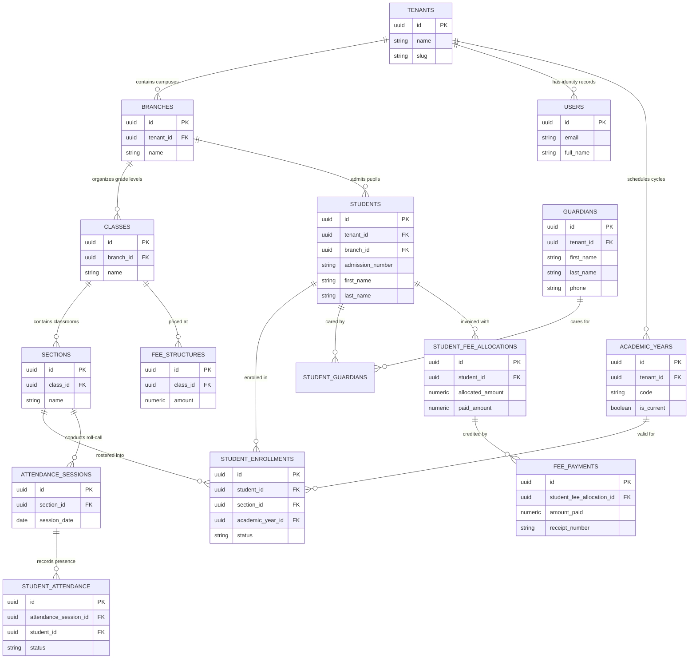
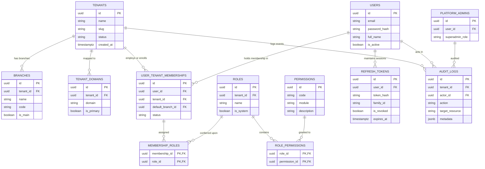
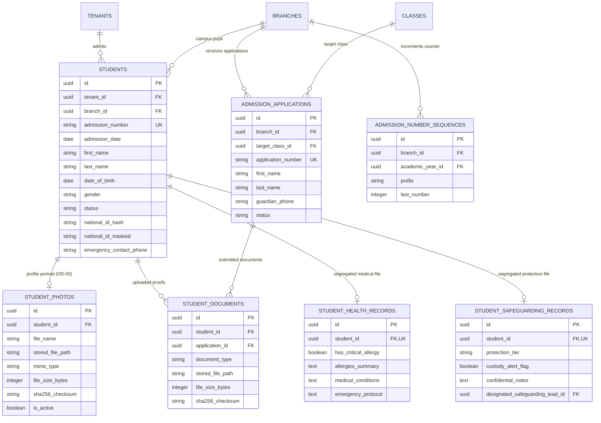
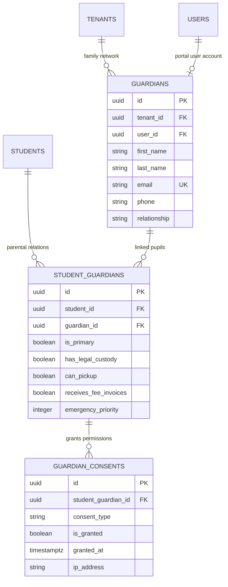
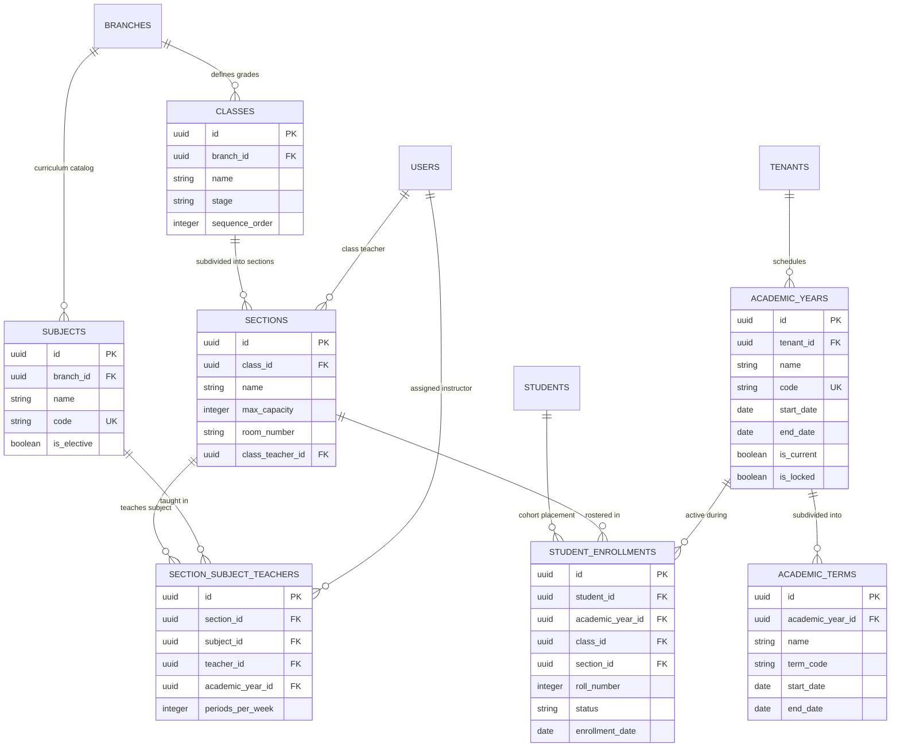
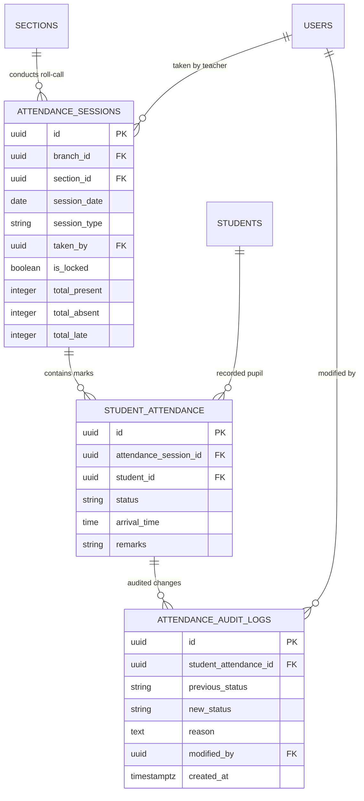
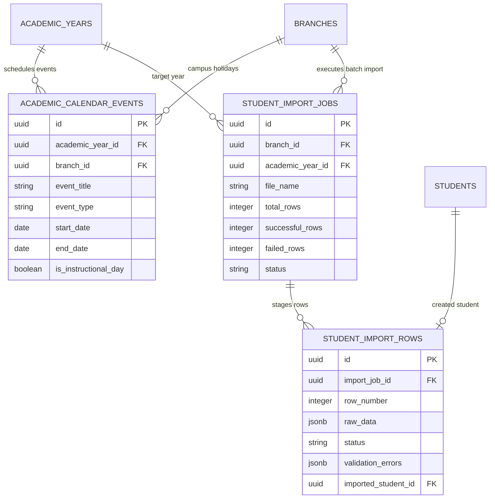
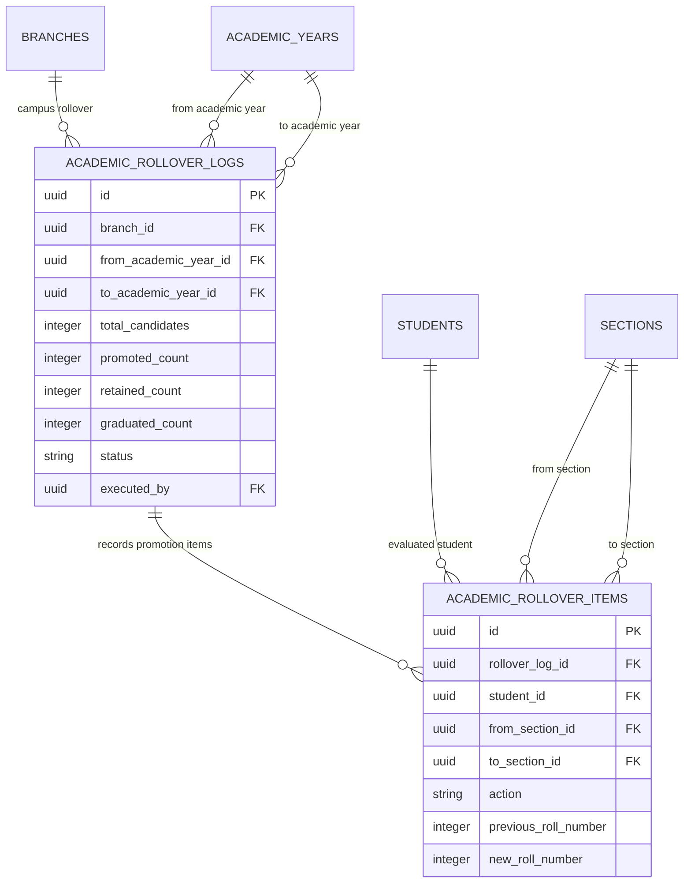
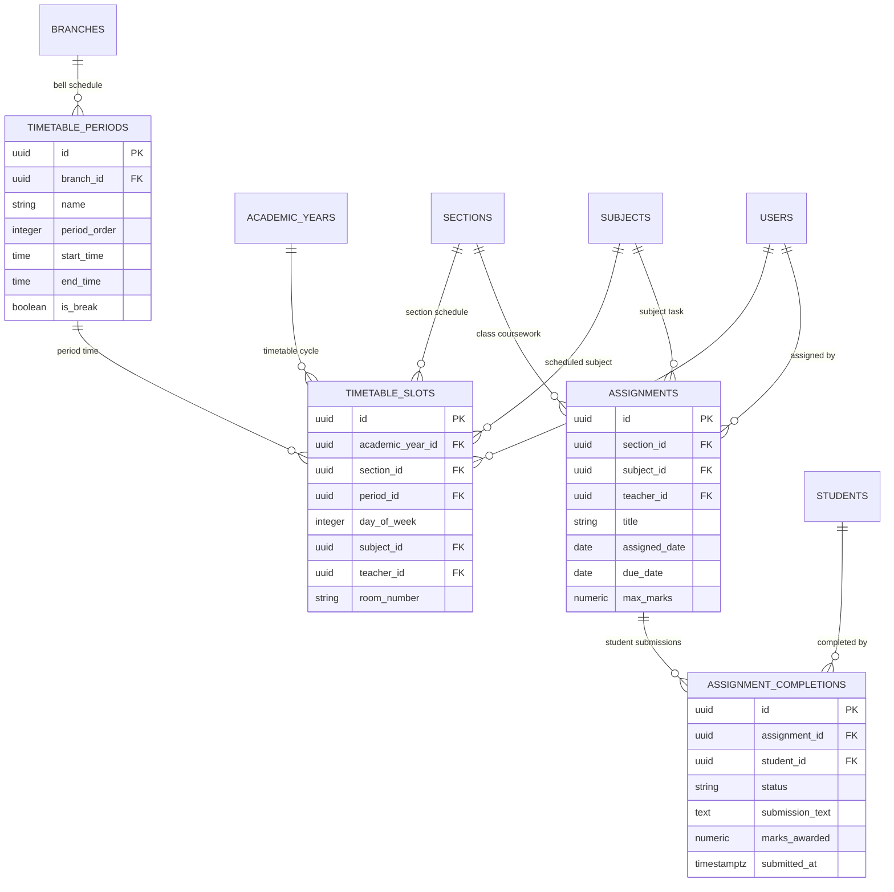
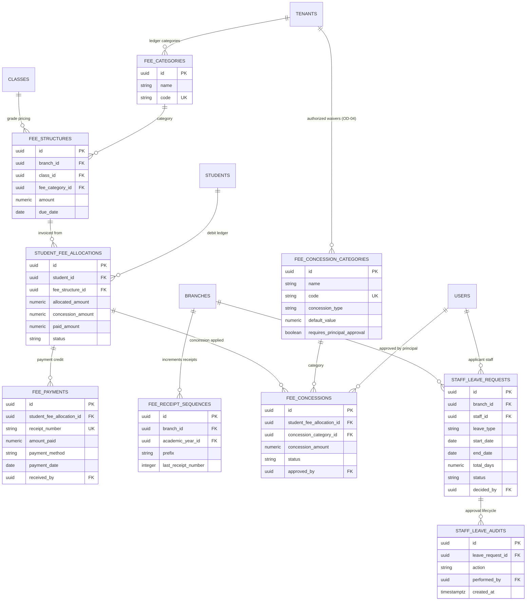

# Document 02: Entity-Relationship (ER) Diagrams

**Document Status:** TECHNICAL SPECIFICATION — APPROVED BASELINE  
**Classification:** Database Architecture & Visual Domain Models  
**Database Topology:** Single Database `auth_db` | Cross-Schema `public` & `sis`  
**Date:** March 2026  
**Author:** Principal Enterprise Data Modeler & Visual Systems Architect  

---

## 1. High-Level System ERD: Cross-Schema Boundary

The following diagram illustrates how the Phase 1 Identity foundation in schema `public` relates to the Phase 2 Student Information System in schema `sis`:

---

## 2. Identity, Multi-Tenancy & RBAC ERD (Schema `public`)

Covers Phase 1 authentication, user accounts, tenant domains, roles, permissions, session tokens, and audit trails:

---

## 3. Student Profiles, Sensitive Records & Admissions ERD

Models student demographics, salted national ID hash, student photos (OD-05), segregated health and safeguarding records, and the prospective admissions pipeline:

---

## 4. Guardian Network, Kinship & Consents ERD

Models parent/guardian identities, M:N kinship mappings, legal custody, and DPDP digital consents:

---

## 5. Academic Structure & Student Enrolment ERD

Models academic years, terms, grade classes, classroom sections, subject catalog, and student cohort enrollments:

---

## 6. Daily Attendance Engine ERD (OD-02)

Models daily section roll-call sessions, individual presence marks, and modification audit logs:

---

## 7. Academic Calendar & Student Bulk Import ERD

Models institutional event schedules and staged batch student ingestion:

---

## 8. Academic Rollover & Promotion Review ERD (OD-01)

Models year-end cohort progression, promotion review wizard logs, and historical student actions:

---

## 9. Timetable & Homework / Assignments ERD

Models bell schedule periods, weekly classroom timetables, teacher conflict prevention, and homework assignments:

---

## 10. Fees, Receipts, Concessions & Staff Leave ERD (OD-04)

Models fee structure schedules, student debits, cashier payment ledger, receipt sequences, Principal concessions (OD-04), and staff leave workflow:

